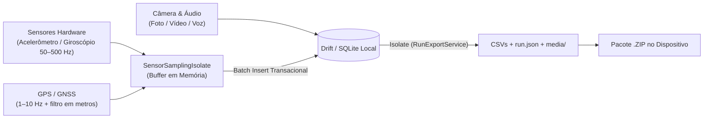

# Roadify Mobile — v1.0.0

<div align="center">

[](https://github.com/ValberSales/roadify-mobile/releases/tag/v1.0.0)
[](https://flutter.dev)
[](https://dart.dev)
[](#-como-executar-o-projeto)
[-orange)](#-arquitetura-do-projeto)
[](#-funcionalidades-da-versão-10)
[](#-licença)

**Coletor Móvel Standalone de Dados Inerciais, GPS e Mídia para Triagem de Pavimentos Asfálticos**

[Download v1.0](#-download-android-apk--v100) •
[Visão Geral](#-visão-geral) •
[Funcionalidades](#-funcionalidades-da-versão-10) •
[Design System](#-design-system--ergonomia) •
[Arquitetura](#-arquitetura-do-projeto) •
[Exportação ZIP](#-especificação-do-pacote-exportado-zip) •
[Como Executar](#-como-executar-o-projeto)

</div>

---

## 📦 Download (Android APK — v1.0.0)

A versão **1.0.0** está disponível para instalação direta em dispositivos Android na aba de **Releases** do repositório:

* ⬇️ **[Baixar Roadify Mobile v1.0.0 (APK)](https://github.com/ValberSales/roadify-mobile/releases/tag/v1.0.0)** — acesse os *Assets* da release `v1.0.0` e faça o download do arquivo `roadify-mobile-v1.0.0.apk`.

---

## 📌 Visão Geral

O **Roadify Mobile** é uma aplicação móvel **100% standalone (offline-first)** desenvolvida em Flutter para monitoramento e triagem preventiva de pavimentos asfálticos. Acoplado ao suporte veicular no para-brisa ou painel, o smartphone atua como uma estação portátil de aquisição inercial, georreferenciamento e registro multimídia, gravando todos os ensaios localmente em SQLite (Drift) e permitindo a exportação estruturada em pacotes `.zip` prontos para análise externa.

---

## ⚡ Funcionalidades da Versão 1.0

### 1. 🏠 Tela Inicial (`HomeScreen`)
* **Card "Iniciar Nova Vistoria":** exibe automaticamente o **último veículo utilizado** e permite abrir o modal de seleção ou cadastro rápido de veículos com um toque.
* **Saúde do Dispositivo em Tempo Real:** monitoramento de **Bateria** (com alerta visual quando abaixo do limite seguro de 20%) e **Sinal GPS** (classificação *Forte / Médio / Fraco* com raio de incerteza em metros).
* **Diagnóstico de Armazenamento:** estimativa de espaço ocupado localmente e contagem total de ensaios salvos no aparelho.
* **Últimas 3 Coletas:** exibe as 3 gravações mais recentes; ao tocar em qualquer card, abre diretamente o **modal de detalhes completo da coleta** com opção de exportação em ZIP.
* **Alternância Rápida de Tema:** botão dedicado no topo para alternar entre Modo Claro e Modo Escuro.

### 2. 🧭 Configuração de Coleta & Gestão de Veículos (`ColetaScreen` + `Veiculos`)
* **Identificação do Ensaio:** trecho, identificador pré-preenchido com data/hora, seleção de veículo cadastrado e odômetro inicial editável.
* **Sensores Obrigatórios:**
  * **Acelerômetro:** presets rápidos (100 a 500 Hz) ou frequência customizada (50–500 Hz).
  * **GPS:** presets rápidos (1, 2, 5, 10 Hz) ou frequência customizada + filtro de **distância mínima em metros** entre pontos gravados.
* **Sensores Complementares Opcionais:**
  * **Giroscópio:** 50–500 Hz.
  * **Câmera:** fotos, vídeos ou ambos; câmera traseira ou frontal; duração máxima de vídeo (1–120 s); disparo manual ou automático por tempo/distância.
  * **Áudio:** gravação de voz manual ou automática por tempo/distância com duração configurável (1–300 s).
* **Etapa de Orientação e Nivelamento Pré-Gravação:** registro da orientação (vertical/horizontal), postura (em pé/deitado) e calibração da tara angular antes de iniciar a pista.
* **Gestão Completa de Veículos:** cadastro, edição, exclusão e definição de veículo padrão com validação de placa (padrão antigo `ABC-1234` e Mercosul `ABC1D23`), ano, tração e quilometragem padrão.

### 3. ⏱️ Cockpit HUD de Coleta em Andamento (`GravacaoScreen`)
* **Telemetria Fixa no Topo:** cronômetro com décimos de segundo, velocímetro GPS (`km/h`), distância percorrida (`km`), indicador de estado (`GRAVANDO` / `PREPARANDO` / `PAUSADA`) e botão de informações completas da coleta.
* **Aquisição de Alta Frequência em Isolate (`SensorSamplingIsolate`):** desacopla a leitura de acelerômetro/giroscópio da thread de UI e grava em lotes transacionais (*batch insert*) no Drift/SQLite, com *Wakelock* ativo e proteção contra interrupção inesperada de sessão (`SessionLifecycleOrchestrator`).
* **Osciloscópio ao Vivo (Janela de 1 Minuto):** gráfico contínuo de 60 segundos (`600` amostras a `10 Hz`) para os eixos X, Y e Z, além de monitoramento em tempo real de **RAM do processo** e **variação de bateria**.
* **Dock Flutuante Inferior (Pill Dock):** barra translúcida flutuante no estilo da navegação do app concentrando os controles de **Foto**, **Vídeo**, **Áudio** e **Finalizar Coleta** (com resumo detalhado antes de salvar).
* **Galeria de Mídias da Sessão:** visualização rápida de fotos e reprodução integrada de vídeos (`video_player`) e áudios (`just_audio`) capturados durante a coleta.

### 4. 🎯 Sensores & Nível Bolha (`SensoresScreen`)
* **Aba Nível Bolha:** modos **Automático**, **Circular 2D** (mesa/horizontal) e **Tubular em T** (suporte veicular/vertical), tolerância de nivelamento $\le 0,5^\circ$ e calibração de tara angular persistida entre sessões.
* **Aba Sinais ao Vivo:** osciloscópios contínuos com **janela de 1 minuto (`60s`)** para **Acelerômetro Triaxial (`m/s²`)**, **Giroscópio Triaxial (`rad/s`)**, **Inclinação Compensada (Roll/Pitch)**, card de **GPS & Cinemática em Tempo Real** e **Referência de Tara Angular**.

### 5. 📁 Gravações e Exportação ZIP (`DadosScreen`)
* Listagem reativa das coletas gravadas com **busca** (por nome, data ou rodovia), **ordenação** (data de criação, quilometragem, ordem alfabética ou tamanho) e atualização por gesto (*pull-to-refresh*).
* **Modal de Detalhes do Ensaio (`RunDetailsBottomSheet`):** odômetro inicial/final, distância percorrida, coordenadas GPS inicial e final, contagem de amostras inerciais, pontos GPS, fotos/vídeos, veículo, aparelho e bateria inicial.
* **Exportação ZIP em Isolate (`RunExportService`):** gera o arquivo `.zip` em segundo plano com barra de progresso e salva no local escolhido pelo usuário via seletor nativo (`flutter_file_dialog`).

### 6. ⚙️ Configurações & Internacionalização (`ConfigScreen` + `l10n`)
* Seletor de tema em tempo real: **Claro**, **Escuro** ou **Sistema**.
* Acesso direto à **Gestão de Veículos** e configuração da **Taxa Padrão do Acelerômetro**.
* **Internacionalização completa em 3 idiomas** com troca instantânea sem reiniciar o app:
  * 🇧🇷 Português (`pt`)
  * 🇺🇸 English (`en`)
  * 🇪🇸 Español (`es`)

---

## 🎨 Design System & Ergonomia

* ☀️ **Modo Claro (Daylight High-Contrast):** fundo branco/cinza suave (`#F8FAFC`), tipografia `GoogleFonts.inter` e identidade em **Verde Floresta** (`#134E3F`) com acentos em **Verde Limão** (`#A3E635`).
* 🌙 **Modo Escuro (Condução Noturna):** superfície escura (`#09120F` / `#111E1A`) com acentos de alto contraste em verde-limão e selo da marca em verde floresta com borda iluminada.
* 💊 **Pill-Shaped Floating Dock:** barra flutuante translúcida (*frosted glass* com `BackdropFilter`) utilizada tanto na navegação principal quanto nos controles de ação da tela de gravação.

---

## 🏗️ Arquitetura do Projeto

O aplicativo utiliza arquitetura **MVVM Feature-First** com injeção de dependências via `GetIt` e banco local reativo via **Drift (SQLite)**:

```text
roadify_app/lib/
├── core/
│   ├── database/                 # AppDatabase, DAOs (RunDao, VehicleDao), Tables e Migrations
│   ├── di/                       # Registro de dependências (GetIt)
│   ├── l10n/                     # LocaleController (persistência e troca de idioma)
│   ├── navigation/               # PillDockScaffold (barra flutuante principal)
│   ├── session/                  # SessionLifecycleOrchestrator (recuperação de sessão)
│   ├── theme/                    # FlexColorScheme, AppColors, AppDimensions, ThemeExtensions
│   ├── utils/                    # SnackbarHelper
│   └── widgets/                  # AppLoadingIndicator, EmptyStateWidget
│
├── features/
│   ├── home/                     # Dashboard inicial, saúde do dispositivo e últimas 3 coletas
│   ├── coleta/                   # Configuração da coleta, permissões, preferências e orientação
│   ├── gravacao/                 # HUD em pista, SensorSamplingIsolate, SensorTraceBuffer e mídias
│   ├── sensores/                 # Nível Bolha (Circular 2D / Tubular T) e Sinais ao Vivo (60s)
│   ├── dados/                    # Histórico local, modal de detalhes e RunExportService (ZIP)
│   ├── veiculos/                 # CRUD de veículos, modal de seleção e validações
│   └── auth_config/              # Configurações gerais (tema, idioma, veículo e taxa padrão)
│
├── l10n/                         # Arquivos .arb, geração flutter gen-l10n e AppLocalizationsCatalog
└── main.dart                     # Ponto de entrada do aplicativo
```

### Fluxo de Aquisição e Exportação



---

## 📄 Especificação do Pacote Exportado (ZIP)

Cada coleta exportada gera um arquivo `coleta_<id>_<AAAAMMDD_HHMMSS>.zip` contendo:

```text
coleta_12_20261119_143201/
├── sensor_readings.csv   # Leituras inerciais paginadas (timestamp UTC, aceleração e giroscópio)
├── gps_points.csv        # Trajetória georreferenciada (lat, lng, altitude, velocidade, rumo, precisão)
├── media.csv             # Índice de mídias capturadas com coordenadas e caminho interno no ZIP
├── run.json              # Metadados completos do ensaio, configuração, dispositivo e veículo
└── media/                # Arquivos originais de foto (.jpg), vídeo (.mp4) e áudio (.m4a)
```

### Cabeçalhos dos arquivos CSV (UTF-8)

* **`sensor_readings.csv`**
  ```csv
  timestamp_utc,accel_x,accel_y,accel_z,gyro_x,gyro_y,gyro_z
  ```
* **`gps_points.csv`**
  ```csv
  timestamp_utc,latitude,longitude,altitude_m,speed_mps,heading_deg,accuracy_m
  ```
* **`media.csv`**
  ```csv
  timestamp_utc,type,file_in_zip,latitude,longitude
  ```

---

## 👥 Equipe

| Integrante | Papel | Principais Contribuições |
| :--- | :--- | :--- |
| **Valber** | Tech Lead & Integrador | Arquitetura MVVM, Design System, `PillDockScaffold`, setup Drift, `HomeScreen` e integração geral. |
| **Lucas** | Desenvolvedor Fullstack | Fluxo de `Coleta`, `GravacaoScreen`, `SensorSamplingIsolate`, captura multimídia e performance. |
| **Allan** | Desenvolvedor Fullstack | `SensoresScreen`, Nível Bolha Digital (Circular 2D e Tubular T), tara angular e osciloscópios ao vivo. |
| **Humberto** | Desenvolvedor Fullstack | `DadosScreen`, gestão de gravações locais, modal de detalhes e `RunExportService` (CSV/JSON/ZIP). |
| **Tiago** | Desenvolvedor Fullstack | `ConfigScreen`, gestão de preferências/temas e internacionalização (PT / EN / ES). |

---

## 🚀 Como Executar o Projeto

### Pré-requisitos
* **Flutter SDK:** canal `stable` (com Dart 3.12+)
* **Dispositivo ou Emulador:** Android ou iOS

### Passo a Passo

1. **Clonar o Repositório:**
   ```bash
   git clone https://github.com/ValberSales/roadify-mobile.git
   cd roadify-mobile/roadify_app
   ```

2. **Instalar Dependências e Gerar Localizações:**
   ```bash
   flutter pub get
   flutter gen-l10n
   ```

3. **Gerar Arquivos do Drift (caso altere tabelas/DAOs):**
   ```bash
   dart run build_runner build --delete-conflicting-outputs
   ```

4. **Executar a Aplicação:**
   ```bash
   flutter run
   ```

5. **Gerar APK Android de Release:**
   ```bash
   flutter build apk --release
   ```

---

## 🧪 Qualidade de Código e Testes

A versão **1.0.0** conta com análise estática limpa (`0` erros/avisos) e **69 testes unitários e de widget** cobrindo banco de dados, buffers, isolamento de amostragem, telas, navegação, responsividade e internacionalização:

```bash
flutter analyze
flutter test
```

---

## 📚 Documentação Complementar

* 🎨 **[Guia Técnico do App & Design System](./roadify_app/README.md)**
* 📋 **[Requisitos Funcionais e Sistêmicos](./REQUISITOS_FUNCIONAIS_E_SISTEMICOS.md)**
* 🗓️ **[Planejamento e Requisitos do Sistema](./REQUISITOS_SISTEMA_ROADIFY.md)**

---

## 📜 Licença

Desenvolvido no âmbito da disciplina de Projeto de Oficina de Engenharia / Computação (UTFPR). Distribuído sob a licença MIT.
